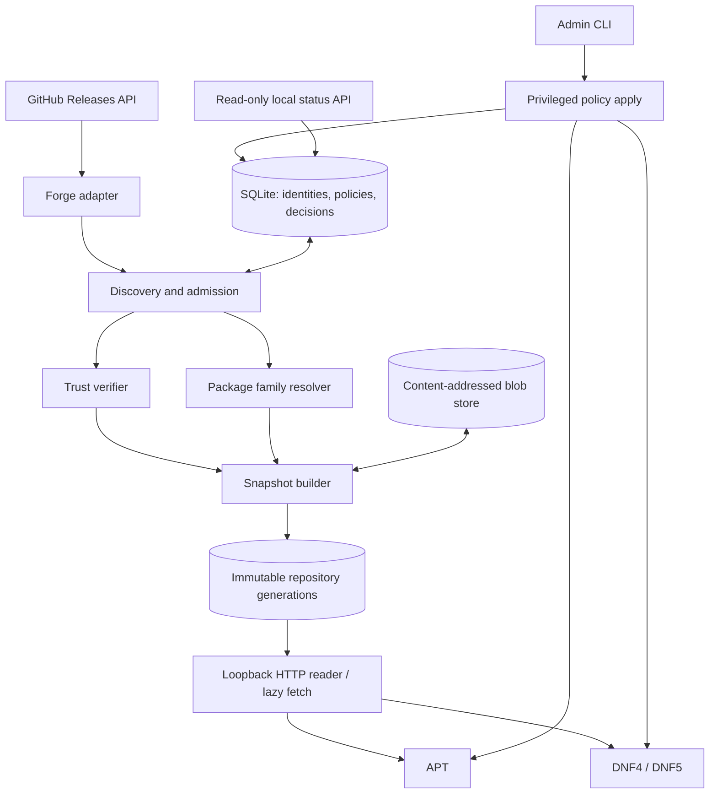

# Architecture overview

**English** · [Русский](../../ru/architecture/overview.md)

## Components

**Control flow:** there is no GUI. `source add` is **not the same as** enabling packages in APT/DNF. The core builds the admissibility decision; adapters translate it into native settings. The native package manager makes the final dependency resolution and installs the package.

**Data flow:** Releases information → preliminary selection → attestation and SHA verification → safe parsing of the genuine DEB/RPM → compatibility/conflict assessment → snapshot → index signing → native repository. On demand, the archive is downloaded into CAS and verified **before it is served** to the package manager.

## Privilege zones

1. `forge/discovery` is only a network client, without root and without the signing key.
2. `artifact_inspector` is an unprivileged restricted process and does not execute maintainer scripts.
3. `policy_engine` trusts the stored identity and native metadata, not arbitrary Release Notes text.
4. `snapshot_publisher` is the sole owner of the local metadata signing key.
5. `repo_server` only reads published content and may request a verified lazy fetch; no changes to the source list over HTTP.
6. `admin_apply` writes our OS configuration files in a limited way and performs reconciliation.
7. `status_api` is read-only, local interface.

## Contracts

- `ForgeAdapter`: `resolve_repository(url) -> immutable identity`, `list_releases(id, cursor)`, `list_assets(release)`, `fetch_asset(asset)`; does not implement APT semantics.
- `ArtifactInspector`: `inspect(bytes, format) -> native metadata`, without running scripts.
- `Verifier`: `verify(bytes, immutable/attestation policy, pinned source) -> evidence` or a rejection.
- `PackagePolicy`: `decide(identity, artifact, os_inventory, existing_sources, user_choice) -> allow/hold/deny` with reason codes.
- `NativeBackend`: `render_repo`, `render_policy`, `simulate`, `install_plan_check` (only functions available to the package manager), `apply/reconcile/rollback`.
- `Publisher`: `build_unsigned_snapshot`, `sign_and_verify`, `commit_generation`; immutable paths and an atomic pointer switch.

`NativeBackend` must not promise more than the package manager is able to do. For example, when the same version is available from different sources, APT does not always allow pinning to a specific file instance.

## Undetermined details

The Rust implementation language and the initial toolchain 1.94.1 are approved by ADR-015. The initial runtime (Tokio only in the network process), SQLite via `rusqlite`, the signature verification and package inspection tools, the native packaging path, and the split into processes are approved by ADR-017 based on the results of prototype P0-004. The exact IPC format, the specific HTTP/GitHub libraries and the production attestation verifier, the key storage format, and the specific range of supported Linux versions require separate decisions and research and are not yet confirmed facts. The initial HTTP approach is systemd socket activation; the fallback is an ordinary service without changing the protocol.
