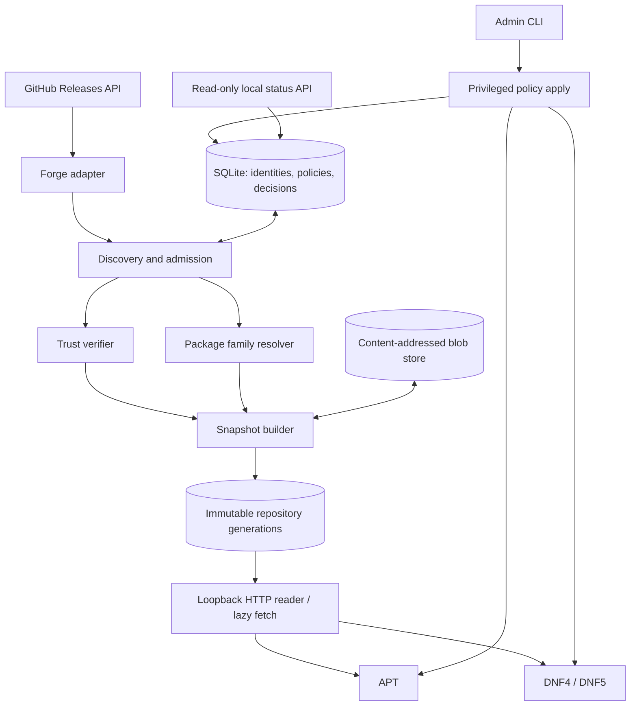

# Architecture overview

**English** · [Русский](../../ru/architecture/overview.md)

## Components

**Control flow:** there is no GUI. `source add` is **not the same as** enabling packages in APT/DNF. The core builds the admissibility decision; adapters translate it into native settings. The native package manager makes the final dependency resolution and installs the package.

**Data flow:** Releases information → preliminary selection → attestation and SHA verification → safe parsing of the genuine DEB/RPM → compatibility/conflict assessment → snapshot → index signing → native repository. On demand, the archive is downloaded into CAS and verified **before it is served** to the package manager.

## Privilege zones

1. `forge/discovery` is only a network client, without root and without the signing key.
2. `artifact_inspector` is an unprivileged restricted process and does not execute maintainer scripts.
3. `policy_engine` trusts the stored identity and native metadata, not arbitrary Release Notes text.
4. `snapshot_publisher` is the sole owner of the local metadata signing key.
5. `repo_server` only reads published content and may request a verified lazy fetch; no changes to the source list over HTTP.
6. `admin_apply` writes our OS configuration files in a limited way and performs reconciliation.
7. `status_api` is read-only, local interface.

## Contracts

- `ForgeAdapter`: `resolve_repository(url) -> immutable identity`, `list_releases(id, cursor)`, `list_assets(release)`, `fetch_asset(asset)`; does not implement APT semantics.
- `ArtifactInspector`: `inspect(bytes, format) -> native metadata`, without running scripts.
- `Verifier`: `verify(bytes, immutable/attestation policy, pinned source) -> evidence` or a rejection.
- `PackagePolicy`: `decide(identity, artifact, os_inventory, existing_sources, user_choice) -> allow/hold/deny` with reason codes.
- `NativeBackend`: `render_repo`, `render_policy`, `simulate`, `install_plan_check` (only functions available to the package manager), `apply/reconcile/rollback`.
- `Publisher`: `build_unsigned_snapshot`, `sign_and_verify`, `commit_generation`; immutable paths and an atomic pointer switch.

`NativeBackend` must not promise more than the package manager is able to do. For example, when the same version is available from different sources, APT does not always allow pinning to a specific file instance.

## HTTP and TLS stack

The GitHub API client (P2-001, `src/github/`) uses `hyper 1.12.0` (features `client`, `http1`), `hyper-util 0.1.21` (feature `tokio`, only the I/O adapter), and `http-body-util 0.1.5`, on Tokio 1.53.3 in the network process (ADR-017). Together with Tokio this is 19 crates on an x86_64 Linux target, against 89 for `reqwest 0.12.28` with rustls (resolution only, both counts include their TLS-free core and `reqwest` the rustls stack). The decisive reason is control rather than size: the client resolves the host itself and vets every address before connecting (R-004 conclusion 11), owns the deadlines and the body limit, and has no connection pool, redirect follower, proxy, or decompression to switch off. One connection per request is enough for the synchronization polling rate.

TLS sits behind the `SecureConnector` seam. The implementation is `RustlsConnector` (`src/github/tls.rs`): `rustls 0.23.46` with the `ring` provider and default features off (only `ring`, `std`, `tls12`; no logging), `tokio-rustls 0.26.6` for the asynchronous stream, and the operating system CA store through `rustls-native-certs 0.8.5`. `aws-lc-rs` is not used, because its `aws-lc-sys` carries the OpenSSL license and needs CMake/NASM, and no bundled root list such as `webpki-roots` (CDLA-Permissive-2.0) is used. `tokio-rustls` is used directly instead of `hyper-rustls`: `hyper-rustls` is built around a connector service for the `hyper-util` pooled client, which would take back the resolution and connection handling that the transport owns on purpose, while `tokio-rustls` wraps a socket already connected to a vetted address. With the TLS layer the network stack is 31 crates of normal dependencies on an x86_64 Linux target, plus the build dependencies of `ring` (`cc`, `shlex`, `find-msvc-tools`).

The connector rules are fixed in code, without configuration switches:

- TLS 1.2 and 1.3 only (rustls implements nothing older); SNI is always the fixed host `api.github.com`; the TCP connection goes to exactly the address the transport vetted, and the name is never resolved again.
- The certificate chain and the host name are always verified. There is no way to disable verification, not even for tests: the loopback tests trust a TEST ONLY root through a constructor that exists only in `cfg(test)` builds.
- ALPN offers only `http/1.1`; a server that selects anything else fails the connection. No early data and no key log.
- The root store is loaded once, when the connector is built. An empty result, or a store with no usable certificate, is the setup error `TlsSetupError::NoRootCertificates`, never a client that cannot verify. A changed system store takes effect after a restart.
- On Linux the roots are the bundle file and directory that `openssl-probe` finds (for example `/etc/ssl/certs/ca-certificates.crt` or `/etc/pki/tls/certs/ca-bundle.crt`). When `SSL_CERT_FILE` or `SSL_CERT_DIR` is set, `rustls-native-certs` reads only those locations instead of the system store, so the service unit must not set them unless the administrator intends to replace the trusted roots.
- A rejected certificate (unknown issuer, wrong name, expired) is `TransportError::Certificate`, distinct from other handshake failures (`TransportError::Tls`), so a TLS-intercepting proxy is reported as such.

Licensing: on 2026-10-20 the project owner allowed narrow per-crate exceptions in `deny.toml` for exactly the crates of this stack that need them: `ring` (`Apache-2.0 AND ISC`; the exception covers ISC), `rustls-webpki` and `untrusted` (ISC), and `subtle` (BSD-3-Clause, an unconditional dependency of `rustls`). The global allow list is unchanged; `rustls`, `tokio-rustls`, `rustls-native-certs`, and `rustls-pki-types` are `MIT OR Apache-2.0` (rustls offers ISC as a third option). The tests generate their throwaway certificates in memory with the dev-dependency `rcgen 0.14.10` (default features off, `crypto` and `ring`; it adds `time` and `yasna` with their dependencies, all `MIT OR Apache-2.0`), so no key file enters the repository. `Cargo.lock` also lists the optional `x509-parser` tree of `rcgen`: Cargo records the targets of weak dependency features (`x509-parser?/verify`) in the lock file even when they are not enabled. Those crates are not built, and `cargo tree` and `cargo deny` do not show them.

Build: `ring 0.17.14` compiles C and assembly through `cc`. It builds on the Windows development host (MSVC). Building on Linux, including packaging and CI, needs a C compiler for the target (gcc or clang). A cross-target check from Windows (`cargo clippy --target x86_64-unknown-linux-gnu`) fails because `x86_64-linux-gnu-gcc` is missing, so Linux checks run on Linux.

A live check on 2026-10-20 from the Windows development host (`cargo test --test github_live -- --ignored --nocapture`, six anonymous requests for `cli/cli`) verified the handshake against the Windows root store and showed that GitHub's `Link` header for `/repositories/{id}/releases` has exactly the shape the pagination rule accepts: `<https://api.github.com/repositories/212613049/releases?per_page=5&page=2>; rel="next", <…&page=41>; rel="last"`, with `prev` and `first` added from page 2. The conditional repeat of `/repositories/{id}` returned 304 for the stored weak ETag, and `x-ratelimit-remaining` still dropped from 58 to 57, as R-004 found. The latest release (`v2.102.0`) reported `immutable: true`, and all 22 of its assets carried a `sha256:` digest that parsed.

## Undetermined details

The Rust implementation language and the initial toolchain 1.94.1 are approved by ADR-015. The initial runtime (Tokio only in the network process), SQLite via `rusqlite`, the signature verification and package inspection tools, the native packaging path, and the split into processes are approved by ADR-017 based on the results of prototype P0-004; ADR-020 replaces its SQLite version requirement with system SQLite 3.34.1 or newer and no `STRICT` tables. ADR-029 fixes the local IPC: one Unix socket per channel from systemd socket units, the authority decided by the channel and the peer uid, and length-prefixed JSON frames. The production attestation verifier, the key storage format, and the specific range of supported Linux versions require separate decisions and research and are not yet confirmed facts. The initial HTTP approach is systemd socket activation; the fallback is an ordinary service without changing the protocol.
