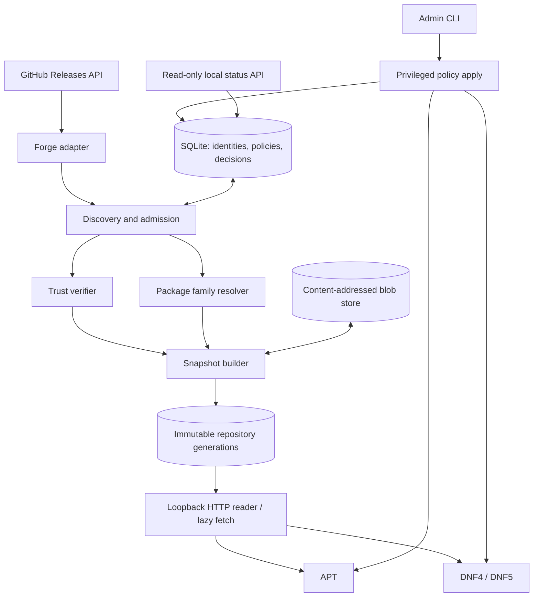

# Общая архитектура

[English](../../en/architecture/overview.md) · **Русский**

## Компоненты

**Контрольный поток:** GUI нет. `source add` **не равно** включению пакетов в APT/DNF. Ядро строит решение о допустимости; адаптеры переводят его в нативные настройки. Штатный менеджер окончательно разрешает зависимости и устанавливает пакет.

**Поток данных:** сведения о Releases → предварительный отбор → проверка аттестации и SHA → безопасный разбор подлинного DEB/RPM → оценка совместимости/конфликтов → снимок → подпись индексов → штатный репозиторий. По требованию архив скачивается в CAS, проверяется **до отдачи** пакетному менеджеру.

## Зоны полномочий

1. `forge/discovery` только сетевой клиент, без root и без ключа подписания.
2. `artifact_inspector` непривилегированный ограниченный процесс, не исполняет maintainer scripts.
3. `policy_engine` доверяет сохранённой идентичности и нативным метаданным, не произвольному тексту Release Notes.
4. `snapshot_publisher` единственный владелец локального ключа подписи метаданных.
5. `repo_server` только читает опубликованное, может запрашивать верифицированную ленивую загрузку; никакого изменения списка источников через HTTP.
6. `admin_apply` ограниченно пишет наши файлы конфигурации ОС и выполняет сверку.
7. `status_api` только чтение, локальный интерфейс.

## Контракты

- `ForgeAdapter`: `resolve_repository(url) -> immutable identity`, `list_releases(id, cursor)`, `list_assets(release)`, `fetch_asset(asset)`; не реализует семантику APT.
- `ArtifactInspector`: `inspect(bytes, format) -> native metadata`, без запуска скриптов.
- `Verifier`: `verify(bytes, immutable/attestation policy, pinned source) -> evidence` либо отказ.
- `PackagePolicy`: `decide(identity, artifact, os_inventory, existing_sources, user_choice) -> allow/hold/deny` с кодами причин.
- `NativeBackend`: `render_repo`, `render_policy`, `simulate`, `install_plan_check` (только доступные менеджеру функции), `apply/reconcile/rollback`.
- `Publisher`: `build_unsigned_snapshot`, `sign_and_verify`, `commit_generation`; неизменяемые пути и атомарная смена указателя.

`NativeBackend` не должен обещать большего, чем способен выполнить менеджер. К примеру, APT при одинаковой версии из разных источников не всегда допускает привязку к определённому экземпляру файла.

## Неопределённые детали

Язык реализации Rust и начальный toolchain 1.94.1 утверждены ADR-015. Начальный runtime (Tokio только в сетевом процессе), SQLite через `rusqlite`, инструменты проверки подписей и инспекции пакетов, путь нативной упаковки и разделение на процессы утверждены ADR-017 по итогам прототипа P0-004. Точный формат IPC, конкретные HTTP/GitHub-библиотеки и production-верификатор attestations, формат хранения ключа и конкретный диапазон поддерживаемых версий Linux требуют отдельных решений и исследований и пока не являются подтверждёнными фактами. Начальный HTTP-подход — systemd socket activation; fallback на обычную службу без изменения протокола.
