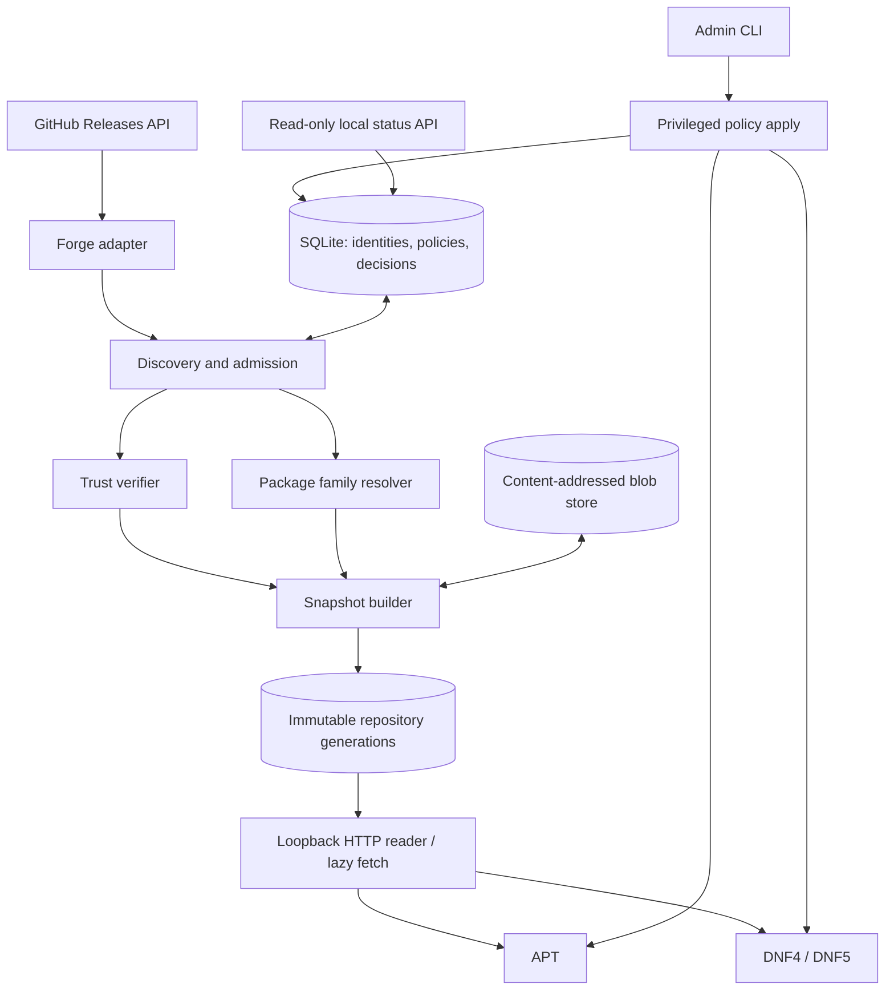

# Общая архитектура

[English](../../en/architecture/overview.md) · **Русский**

## Компоненты

**Контрольный поток:** GUI нет. `source add` **не равно** включению пакетов в APT/DNF. Ядро строит решение о допустимости; адаптеры переводят его в нативные настройки. Штатный менеджер окончательно разрешает зависимости и устанавливает пакет.

**Поток данных:** сведения о Releases → предварительный отбор → проверка аттестации и SHA → безопасный разбор подлинного DEB/RPM → оценка совместимости/конфликтов → снимок → подпись индексов → штатный репозиторий. По требованию архив скачивается в CAS, проверяется **до отдачи** пакетному менеджеру.

## Зоны полномочий

1. `forge/discovery` только сетевой клиент, без root и без ключа подписания.
2. `artifact_inspector` непривилегированный ограниченный процесс, не исполняет maintainer scripts.
3. `policy_engine` доверяет сохранённой идентичности и нативным метаданным, не произвольному тексту Release Notes.
4. `snapshot_publisher` единственный владелец локального ключа подписи метаданных.
5. `repo_server` только читает опубликованное, может запрашивать верифицированную ленивую загрузку; никакого изменения списка источников через HTTP.
6. `admin_apply` ограниченно пишет наши файлы конфигурации ОС и выполняет сверку.
7. `status_api` только чтение, локальный интерфейс.

## Контракты

- `ForgeAdapter`: `resolve_repository(url) -> immutable identity`, `list_releases(id, cursor)`, `list_assets(release)`, `fetch_asset(asset)`; не реализует семантику APT.
- `ArtifactInspector`: `inspect(bytes, format) -> native metadata`, без запуска скриптов.
- `Verifier`: `verify(bytes, immutable/attestation policy, pinned source) -> evidence` либо отказ.
- `PackagePolicy`: `decide(identity, artifact, os_inventory, existing_sources, user_choice) -> allow/hold/deny` с кодами причин.
- `NativeBackend`: `render_repo`, `render_policy`, `simulate`, `install_plan_check` (только доступные менеджеру функции), `apply/reconcile/rollback`.
- `Publisher`: `build_unsigned_snapshot`, `sign_and_verify`, `commit_generation`; неизменяемые пути и атомарная смена указателя.

`NativeBackend` не должен обещать большего, чем способен выполнить менеджер. К примеру, APT при одинаковой версии из разных источников не всегда допускает привязку к определённому экземпляру файла.

## Стек HTTP и TLS

Клиент GitHub API (P2-001, `src/github/`) использует `hyper 1.12.0` (функции `client`, `http1`), `hyper-util 0.1.21` (функция `tokio`, только адаптер ввода-вывода) и `http-body-util 0.1.5` поверх Tokio 1.53.3 в сетевом процессе (ADR-017). Вместе с Tokio это 19 crates для цели x86_64 Linux против 89 у `reqwest 0.12.28` с rustls (только разрешение зависимостей; оба числа включают ядро без TLS, а у `reqwest` — ещё и стек rustls). Решающая причина — контроль, а не размер: клиент сам разрешает имя хоста и проверяет каждый адрес до подключения (вывод 11 R-004), сам управляет сроками и пределом тела ответа, и у него нет пула соединений, следования перенаправлениям, прокси и распаковки, которые пришлось бы отключать. Одного соединения на запрос достаточно для частоты опроса при синхронизации.

TLS находится за швом `SecureConnector`. Реализация — `RustlsConnector` (`src/github/tls.rs`): `rustls 0.23.46` с провайдером `ring` и отключёнными функциями по умолчанию (только `ring`, `std`, `tls12`; без журналирования), `tokio-rustls 0.26.6` для асинхронного потока и системное хранилище корневых сертификатов через `rustls-native-certs 0.8.5`. `aws-lc-rs` не используется, потому что его `aws-lc-sys` несёт лицензию OpenSSL и требует CMake/NASM; встроенный список корней вроде `webpki-roots` (CDLA-Permissive-2.0) тоже не используется. `tokio-rustls` применяется напрямую, а не через `hyper-rustls`: `hyper-rustls` построен вокруг сервиса-коннектора для клиента `hyper-util` с пулом, который забрал бы себе разрешение имён и установку соединения, намеренно оставленные транспорту, а `tokio-rustls` оборачивает сокет, уже подключённый к проверенному адресу. Вместе с уровнем TLS сетевой стек — 31 crate обычных зависимостей для цели x86_64 Linux плюс зависимости сборки `ring` (`cc`, `shlex`, `find-msvc-tools`).

Правила коннектора зафиксированы в коде, без переключателей конфигурации:

- Только TLS 1.2 и 1.3 (более старых версий в rustls нет); SNI — всегда фиксированный хост `api.github.com`; TCP-соединение открывается ровно на адрес, проверенный транспортом, и имя повторно не разрешается.
- Цепочка сертификатов и имя хоста проверяются всегда. Отключить проверку нельзя, даже в тестах: loopback-тесты доверяют корню TEST ONLY через конструктор, который существует только в сборках `cfg(test)`.
- ALPN предлагает только `http/1.1`; если сервер выбирает что-то другое, соединение завершается ошибкой. Без early data и без журнала ключей.
- Хранилище корней загружается один раз, при создании коннектора. Пустой результат или хранилище без пригодных сертификатов — ошибка настройки `TlsSetupError::NoRootCertificates`, а не клиент, который ничего не может проверить. Изменение системного хранилища вступает в силу после перезапуска.
- В Linux корни — это файл-сборка и каталог, найденные `openssl-probe` (например, `/etc/ssl/certs/ca-certificates.crt` или `/etc/pki/tls/certs/ca-bundle.crt`). Если задана `SSL_CERT_FILE` или `SSL_CERT_DIR`, `rustls-native-certs` читает только эти пути вместо системного хранилища, поэтому юнит службы не должен их задавать, если администратор не собирается заменить доверенные корни.
- Отвергнутый сертификат (неизвестный издатель, чужое имя, истёкший срок) — `TransportError::Certificate`, отдельно от прочих сбоев рукопожатия (`TransportError::Tls`), поэтому TLS-перехватывающий прокси сообщается именно как таковой.

Лицензии: 20.10.2026 владелец проекта разрешил узкие исключения для отдельных crates в `deny.toml` ровно для тех crates этого стека, которым они нужны: `ring` (`Apache-2.0 AND ISC`; исключение покрывает ISC), `rustls-webpki` и `untrusted` (ISC) и `subtle` (BSD-3-Clause, безусловная зависимость `rustls`). Глобальный список разрешённых лицензий не изменён; `rustls`, `tokio-rustls`, `rustls-native-certs` и `rustls-pki-types` распространяются под `MIT OR Apache-2.0` (rustls предлагает ISC третьим вариантом). Тесты создают одноразовые сертификаты в памяти с помощью dev-зависимости `rcgen 0.14.10` (функции по умолчанию отключены, включены `crypto` и `ring`; она добавляет `time` и `yasna` с их зависимостями, все под `MIT OR Apache-2.0`), поэтому ни один файл ключа не попадает в репозиторий. `Cargo.lock` также перечисляет необязательное дерево `x509-parser` из `rcgen`: Cargo записывает в lock-файл цели слабых функций зависимостей (`x509-parser?/verify`), даже когда они не включены. Эти crates не собираются, и `cargo tree` и `cargo deny` их не показывают.

Сборка: `ring 0.17.14` компилирует C и ассемблер через `cc`. Он собирается на хосте разработки Windows (MSVC). Сборке в Linux, включая упаковку и CI, нужен компилятор C для целевой платформы (gcc или clang). Кросс-проверка с Windows (`cargo clippy --target x86_64-unknown-linux-gnu`) падает из-за отсутствия `x86_64-linux-gnu-gcc`, поэтому проверки для Linux выполняются в Linux.

Живая проверка 20.10.2026 с хоста разработки Windows (`cargo test --test github_live -- --ignored --nocapture`, шесть анонимных запросов для `cli/cli`) проверила рукопожатие по хранилищу корней Windows и показала, что заголовок `Link` GitHub для `/repositories/{id}/releases` имеет ровно ту форму, которую принимает правило пагинации: `<https://api.github.com/repositories/212613049/releases?per_page=5&page=2>; rel="next", <…&page=41>; rel="last"`, а со второй страницы добавляются `prev` и `first`. Условный повтор `/repositories/{id}` вернул 304 для сохранённого слабого ETag, и `x-ratelimit-remaining` всё равно уменьшился с 58 до 57, как и обнаружило R-004. Последний релиз (`v2.102.0`) сообщил `immutable: true`, и у всех 22 его assets был digest `sha256:`, который успешно разобран.

## Неопределённые детали

Язык реализации Rust и начальный toolchain 1.94.1 утверждены ADR-015. Начальный runtime (Tokio только в сетевом процессе), SQLite через `rusqlite`, инструменты проверки подписей и инспекции пакетов, путь нативной упаковки и разделение на процессы утверждены ADR-017 по итогам прототипа P0-004; ADR-020 заменяет его требование к версии SQLite: системная SQLite 3.34.1 или новее без таблиц `STRICT`. ADR-029 фиксирует локальный IPC: отдельный Unix-сокет на каждый канал из socket-юнитов systemd, полномочия определяют канал и uid собеседника, кадры JSON с префиксом длины. Production-верификатор attestations, формат хранения ключа и конкретный диапазон поддерживаемых версий Linux требуют отдельных решений и исследований и пока не являются подтверждёнными фактами. Начальный HTTP-подход — systemd socket activation; fallback на обычную службу без изменения протокола.
